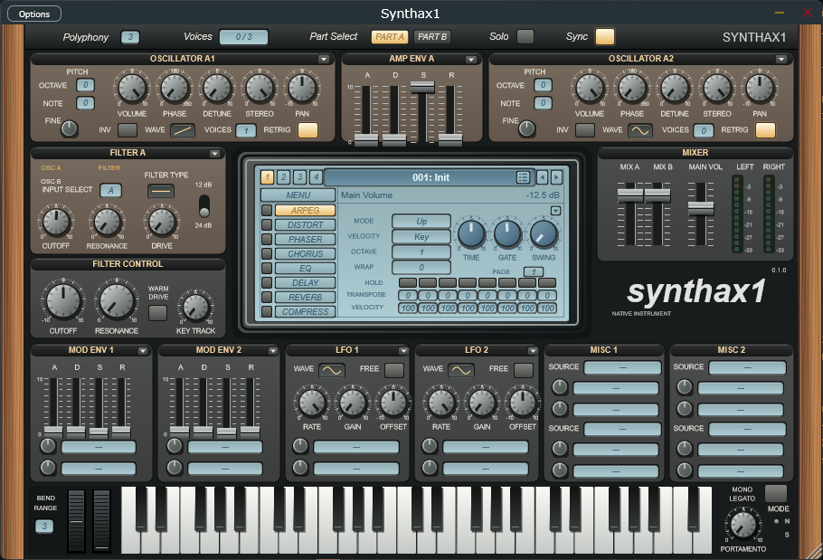
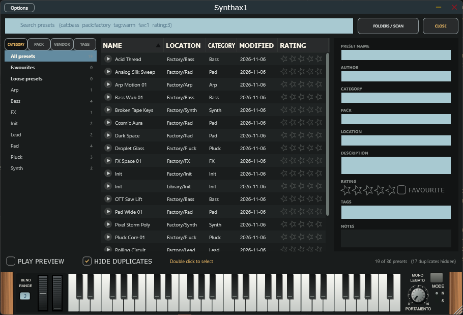

# Synthax1

A virtual analog synthesizer plugin for Windows, macOS and Linux (VST3, plus AU on macOS, and a standalone app), with a preset browser built for very large libraries. Features an import tool for legacy patches created in Sylenth1®.



## Highlights

- **Two stereo parts** with four oscillators of up to eight unison voices each, two filters per part with routing and a shared filter control, two amp envelopes, two modulation envelopes, two LFOs, eight modulation slots, a 16-step arpeggiator and seven effects (distortion, phaser, chorus, EQ, reverb, delay, compressor).
- **Legacy patch import and export.** Reads legacy Sylenth1® `.fxp` programs and `.fxb` banks (all container versions, compressed or not) and writes banks back, unedited programs byte for byte. Assembling a new bank from favorite presets takes a few clicks. See [docs/SYLENTH_IMPORT.md](docs/SYLENTH_IMPORT.md).
- **Sound matched by measurement.** Oscillators, unison, filters, drive, envelopes, LFOs, the arpeggiator, reverb and distortion were compared with the original through offline renders and fitted to the measurements. The method, the numbers and the remaining gaps are in [docs/SOUND_PARITY.md](docs/SOUND_PARITY.md).
- **A preset browser for big libraries.** Point it at one folder and it finds every bank and preset below it, treats them alike, and lists them by category, pack, vendor or tag, with search, favorites, notes, duplicate hiding and an optional middle C preview. A library of 279,000 programs lists in seconds from a cache.
- **Automation for everything.** Every control is a host parameter, including the pitch bend and mod wheel, and a right click offers the host's own automation menu.
- **Unlimited undo and redo** of parameter edits (Ctrl+Z, Ctrl+Y), Ctrl+click to reset a knob to its middle (a switch or list to its Init value), and knob readouts on the familiar 0 to 10 scale with three decimals.



## Build

Requires CMake 3.24 or newer, a C++20 compiler and, on Linux, the usual JUCE development packages (see `.github/workflows/build.yml`).

```sh
cmake -S . -B build -G Ninja -DCMAKE_BUILD_TYPE=Release
cmake --build build --parallel
ctest --test-dir build --output-on-failure
```

CMake downloads JUCE 8.0.13; pass `-DSYNTHAX1_JUCE_PATH=/path/to/JUCE` to use an existing checkout. The plugins are written to `build/Synthax1Plugin_artefacts/Release`. GitHub Actions builds and tests all three platforms on every push and attaches the VST3 (and AU on macOS) bundles to each run.

## Documentation

The [documentation index](docs/index.md) lists the specification, architecture, preset schema, validation and release notes.

## License

[MIT](LICENSE) © BandPass Records.

Synthax1 uses [JUCE](https://juce.com), which is available under the AGPLv3 or a commercial license; builds you distribute must comply with one of them. Sylenth1 is a registered trademark of LennarDigital. This product is not affiliated with or endorsed by LennarDigital.
